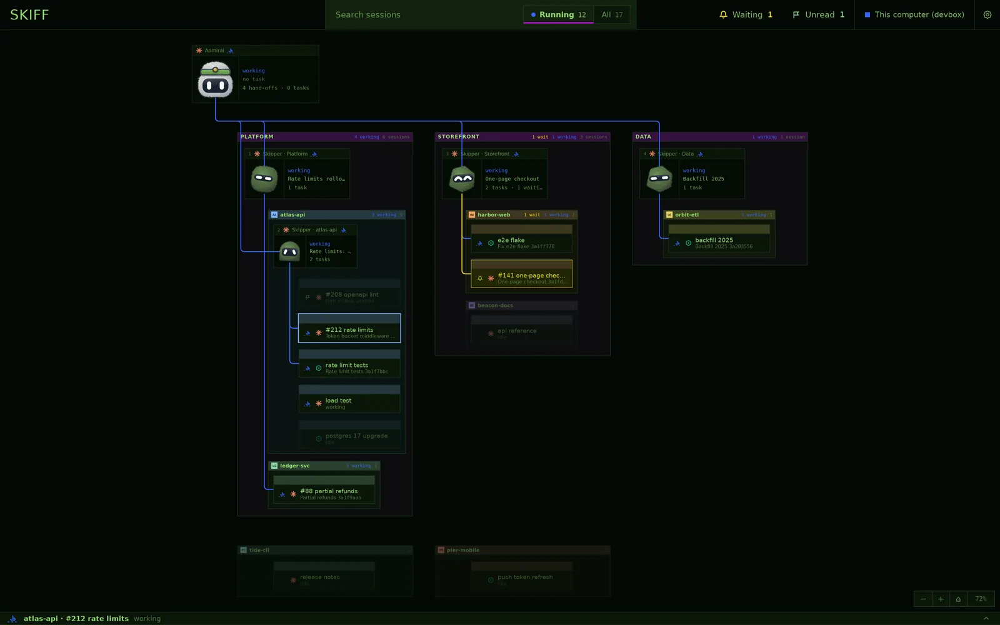
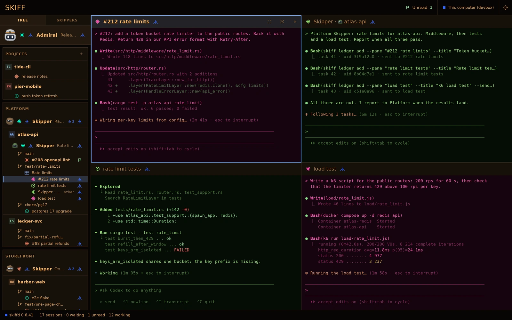

<h1 align="center"></h1>

<p align="center">
  <a href="https://github.com/solutionscay/skiff/releases/latest"></a>
  <a href="LICENSE"></a>
  
</p>

<!-- hero: headline and tagline match the skiff-web home hero; the image is local; check with scripts/hero-sync.py -->
<h3 align="center">The multi-agent coding terminal.</h3>

<p align="center">Run Claude Code, Codex and other agents in parallel. They send each other tasks and report back.</p>

<p align="center"><a href="https://skiff.solutionscay.com/"></a></p>
<!-- /hero -->

Skiff is a terminal app for coding agents, on Linux and macOS. You code with Claude Code,
Codex and other agents in its panes, many at once, across projects and Git worktrees.
Each pane shows what its agent needs: a bell when it asks for approval, a flag when it
finished a turn out of sight. Admiral, the Skiff agent, hands tasks to your other agents
and to project Skippers, and collects their results in a ledger. Any agent can do the
same with the `skiff` command.

## Philosophy

Skiff manages sessions. The apps you already have do everything else. Skiff does not
edit files: it opens them in the editor, diff tool or file manager you set in
Settings › Open with.

Sessions outlive the window. `skiffd`, a daemon, owns every terminal. Close the window
and the agents keep running.

Skiff stays out of your agents' setup. It installs no hooks or plugins. It reads a
session's state from its screen and from the program in front of the terminal. All
settings live in one file, `projects.toml`.

## Install

Download the latest [release](https://github.com/solutionscay/skiff/releases/latest):

- Linux (x86_64): `.deb`, `.rpm` or AppImage
- macOS (Apple Silicon): `.dmg`, signed and notarized

The `skiff` command ships with the app. It drives sessions from a shell or from an agent.
See the [CLI](https://github.com/solutionscay/skiff/wiki/CLI) page.

## Start

1. Add a project: a Git repository or a plain folder.
2. Make worktrees in it, and start agent or shell sessions in each one.
3. Put related sessions side by side in a named group.
4. Click the top row, Admiral, to start the Skiff agent. It hands tasks to your sessions
   and tracks them in a ledger.

<p align="center"><br><sub>The Tree tab with the Rate limits group, then the Skippers tab with the Platform Skipper at work.</sub></p>

Press F1 for every key. Press Ctrl+Shift+A (Cmd+Shift+A on macOS) for Mission control,
the whole agent hierarchy as a graph. The [wiki](https://github.com/solutionscay/skiff/wiki)
has the details: [Skiff agent](https://github.com/solutionscay/skiff/wiki/Skiff-agent),
[Open with](https://github.com/solutionscay/skiff/wiki/Open-with),
[skiffd](https://github.com/solutionscay/skiff/wiki/skiffd).

The website has the [user guide](https://skiff.solutionscay.com/guides/skiff-user-guide/) and
three guides on the work Skiff is for: [run coding agents in parallel](https://skiff.solutionscay.com/guides/run-coding-agents-in-parallel/),
[Git worktrees for coding agents](https://skiff.solutionscay.com/guides/git-worktrees-for-coding-agents/) and
[keep agent sessions running](https://skiff.solutionscay.com/guides/keep-agent-sessions-running/).

## Layout

```
crates/skiff-host-api Host contract types (no I/O)
crates/skiff-core    session model, wire protocol, projects.toml config, git, themes
crates/skiffd        daemon: owns every PTY, serves clients over a Unix socket
crates/skiff-host    Host data plane: projects, Git, files, images, ledger and Skipper over the Host API
crates/skiff-client  async client for the socket; Skiff agent setup shared by the app and the CLI
crates/skiff-cli     the `skiff` command: sessions, groups, the Skiff agent's ledger and watcher
apps/desktop         Tauri v2 app, vanilla TypeScript + xterm.js
  src-tauri          Rust side: config, git, open with, the skiffd connection, menus
  src/app            state, actions, keyboard, startup connections
  src/ui             DOM builders, dialogs, menus
  src/workspace      session tree, fleets, layouts, files, project actions
  src/terminal       xterm runtime, panes, search, clipboard, font size
  src/appearance     themes, colors, icons, settings
  src/i18n           UI words: t() and tn(), catalogs en.ts (source), es.ts and zh.ts
  src/platform       wire types, IPC bytes, file actions
  src/diagnostics    latency traces and memory counts
  src/styles         styles by owner, imported in cascade order
```

## Development

Every window has one selected Host. Sessions, projects, Git, files, images, ledger,
Skipper and agents come from that Host through the [Host API](docs/v2/Host-API.md).
**This Mac** is the local Host. Add an SSH Host in Settings › Hosts to work with a
server through the same surfaces. The app keeps only client-owned settings, window
state, known Hosts and local Open with applications.

```
cd apps/desktop && pnpm install && pnpm tauri dev
CARGO_BUILD_JOBS=8 cargo test -p CRATE TEST_NAME
cd apps/desktop && pnpm bundle   # packages for this OS, with skiffd, skiff and skiff-host inside
```

During a task, run only the tests for the code you changed. See
[AGENTS.md](AGENTS.md#testing). The [Glossary](https://github.com/solutionscay/skiff/wiki/Glossary)
names the parts of the screen and the session tree.

A rebuild does not replace the running daemon. Run `skiff daemon reload` after
`cargo build -p skiffd`. When the daemon changes, raise the skiffd version in
`crates/skiffd/Cargo.toml` and `crates/skiff-core/Cargo.toml`. When the reload handover
metadata changes, raise `HANDOVER` in `crates/skiffd/src/session/reload.rs`. Set
`SKIFF_SOCKET` to another path for a test daemon with its own state. See
[skiffd › Development](https://github.com/solutionscay/skiff/wiki/skiffd#development).

A `v*` tag builds every package and the signed server bundles in CI. It attaches them to a draft release.

## License

MIT
