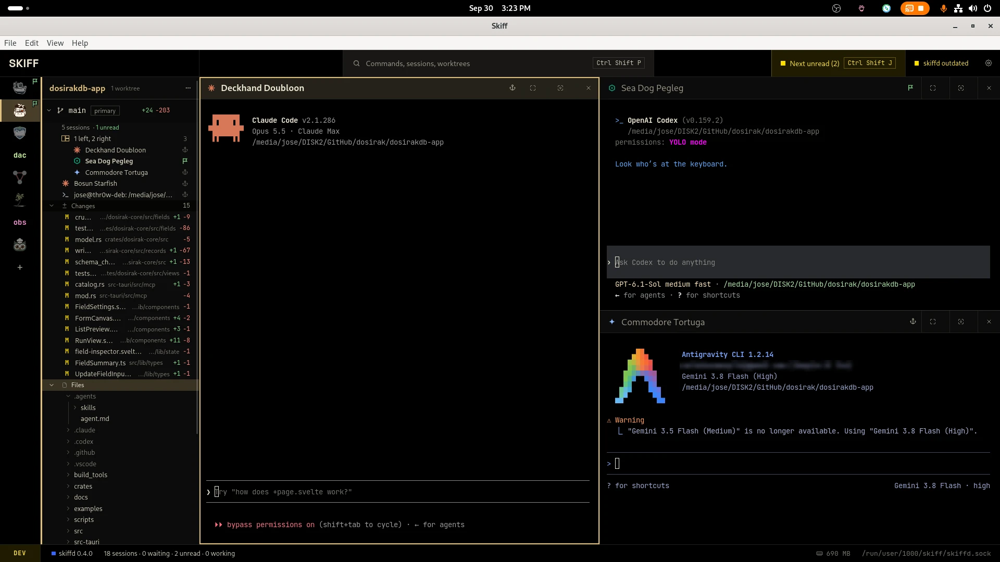

<p align="center"></p>

<h1 align="center">Skiff</h1>

<p align="center">
  <a href="https://github.com/solutionscay/skiff/releases/latest"></a>
  <a href="LICENSE"></a>
  
</p>

A minimalist desktop workspace for coding agents on Linux and macOS.

Skiff keeps sessions organized across projects and Git worktrees. Editing and
previews stay in the apps you already use.

<p align="center"></p>

## Philosophy

Skiff has a deliberately small scope: reduce the mental effort of managing
multiple sessions, and use existing apps for the rest.

Project and terminal themes give you a visual cue about where you are. Named
groups and terminal layouts keep related sessions together, so you can arrange
them to suit the work.

## How it works

You add a project (a Git repository, or a plain folder), make worktrees in it, and start agent or shell sessions in each worktree. A plain folder has no worktrees or changes; its sessions start in the folder. Sessions can sit side by side in a named group. A project, a group and a session can each have a terminal theme.

Skiff does not edit files. Each worktree lists its changed files and its file tree. Select a changed file and its diff shows in the main area. Select a file and its preview shows there. Press Enter to open the file in the app you choose under Settings › Open with (see the [wiki](https://github.com/solutionscay/skiff/wiki/Open-with)), or to show a folder in your file manager. Each Open with row says where it opens: in the peek for a terminal tool, or as an app. `skiff open-with ls` and `skiff open-with set` read and set the same rows. If a program is missing, Skiff names it. There are no plugins, no hooks into agent configs, and no automations. Settings live in one file, `projects.toml`.

Sessions run in `skiffd`, a daemon that owns every PTY. You can close the window and the agents keep running. When the window opens again, each terminal shows its last screen.

Skiff makes its agent folder, `~/skiff-agent`, when the app starts. The folder holds the
image cache in `cache/`, so dropped and pasted images work before any Skipper runs. If
Skiff cannot make the folder, the Images and Disk use features say so in one line.

The Skiff agent, Skipper, is a coordinator: one agent session in that folder. Its row is
always at the top of the tree, and no Skipper starts by itself. The first click on the
row starts it, and its first start adds its files to the folder. It sends tasks to sessions in your
projects and records them in a SQLite ledger (`skiff ledger`). `skiff watch` tells it when
a task's pane ends a turn, exits or restarts. `skiff skipper` attaches to it from any
terminal, an SSH login included, and starts it first when it does not run. Ctrl-\
detaches. See the [wiki Skiff agent page](https://github.com/solutionscay/skiff/wiki/Skiff-agent).

The Ledger panel at the right of Skipper's pane sorts the work into Working, Open and
Finished. Work is a plan with its tasks, or a task with no plan. It moves to Finished
when every task in it is done and reported, or when Skipper closes it on your word
(`skiff ledger close`). `skiff ledger reopen` opens it again and keeps it open until a
task in it changes state. `skiff ledger prune` removes only closed work. Ctrl+Alt+Shift+L folds the
panel to a rail with the count of tasks that need you. Focus mode keeps the panel and
maximize hides it. Only Skipper's session can change the ledger. A shell outside Skiff,
such as an SSH login, adds `--person` to change a row.

A project can have a Skipper of its own, and a fleet can have one for all its projects.
Pick Start project Skipper in a project's menu or Start fleet Skipper in a fleet's menu.
Skipper hands
work to them with `skiff ledger handoff PROJECT` or `skiff ledger handoff FLEET`. Each one
changes only its own rows. A project has one Skipper at most: when a project with a
project Skipper comes under a running fleet Skipper, the fleet Skipper takes its rows over
after one confirm, and the project Skipper stops when it is idle.

Settings › Skippers sets the name, the agent and model of the Skipper, and one agent and
model for project and fleet Skippers ("Same as Skipper" by default). Its Instructions
table lists one file per Skipper: `AGENTS.md`, the base of every Skipper, and a
`SKIPPER.md` with the scope section only in `fleets/<fleet>/` and `projects/<project>/`.
Skiff writes each file once and never writes over an edit. The status is none,
template, edited, or edited · template changed. Edit opens the file as Open with › Text
files says. Reset… writes the template again and keeps the old file as `<name>.bak`. A
file with status template follows a new template at the Skipper's next start. Settings ›
Task types holds the task types.

<p align="center"></p>

Settings › Skippers › Folder › Change… moves the folder: `~/skiff-agent`, `~/.skiff-agent`, or
any folder of its own outside a Git repository, a project, an agent's home or a Hermes
profile. A new or empty folder gets a copy (checked before the switch) or a new ledger. A
folder that is already a Skiff folder is switched to as it is; Skiff never merges two
ledgers. The old folder keeps every file and gets `MOVED.md`. The conversation does not
move: Skipper starts a new one in the new folder. `skiff skipper --move-to PATH [--dry-run]`
does the same from a terminal.

Settings › Task types names the agent and the model that Skipper starts for each kind of
task: `skiff new --type review`. Each type can have an instruction file,
`types/<type>.md` in the agent folder. Edit in its row makes the file and opens it. The
agent gets the file at start, on top of the project's own `AGENTS.md` or `CLAUDE.md`:
claude, codex, grok, opencode and kimi each take it their own way. gemini, hermes and
custom agents cannot take one, and the row shows an error. An empty file is no file.

Each session row shows what needs you. A bell means an agent asks for approval. A flag means an agent finished its turn, or a shell command ended, while you were in another pane. `skiffd` reads this from the screen and from the program in front of the terminal, not from hooks.

## Install

Download the latest [release](https://github.com/solutionscay/skiff/releases/latest):

- Linux (x86_64): `.deb`, `.rpm` or AppImage
- macOS (Apple Silicon): `.dmg`, signed and notarized

The `skiff` command drives sessions and groups from a shell or an agent. It ships with the app and updates with it. The `.deb` and `.rpm` install it to `/usr/bin`. The AppImage copies it to `~/.local/bin` when it starts. The macOS app links it into `/usr/local/bin`, or `/opt/homebrew/bin` when it can write there. Otherwise run Help › Install skiff command… once. At each start the release app points a `skiff` link there at itself again, also one that a checkout build left, so the command updates with the app. It replaces only the link, never the file the link points at or a file of yours. See the [wiki CLI page](https://github.com/solutionscay/skiff/wiki/CLI).

## Themes

Themes apply to the app, a project, a group, or a session. A group theme applies
to every session in the group. A session theme replaces the project theme. A
project theme replaces the app theme.

Skiff ships 34 dark themes, curated from Foot palettes. There is no light
theme. Their Skiff TOML files live in `crates/skiff-core/themes`. Ultraviolet is
the default.
Each file declares `color_family` and `main_color`. The picker uses these
values for its color filter and swatch. Themes without a declared color group
show as Unclassified.

Use the theme picker to search by name or filter by main color.
Select **Import themes…** to add multiple files. Skiff supports its own TOML,
Superset JSON, Foot INI, Alacritty TOML, Ghostty, and base16 or base24 YAML.
Each file needs a foreground, a background, and all 16 ANSI colors. Import
keeps existing files with the same name and reports files it cannot read.

**Open theme folder** opens the `themes` folder beside `projects.toml`.
You can copy files there. The list refreshes when you return to Skiff. There is no theme count
limit. Theme files contain color values, so a large collection needs little space.

## Layout

```
crates/skiff-core    session model, wire protocol, projects.toml config, git, themes
crates/skiffd        daemon: owns every PTY, serves clients over a Unix socket
crates/skiff-client  async client for the socket; Skiff agent setup shared by the app and the CLI
crates/skiff-cli     the `skiff` command: sessions, groups, the Skiff agent's ledger and watcher
apps/desktop         Tauri v2 app, vanilla TypeScript + xterm.js
  src-tauri          Rust side: config, git, open with, the skiffd connection, menus
  src/app            state, actions, keyboard, startup connections
  src/ui             DOM builders, dialogs, menus
  src/workspace      session tree, fleets, layouts, files, project actions
  src/terminal       xterm runtime, panes, search, clipboard, font size
  src/appearance     themes, colors, icons, settings
  src/platform       wire types, IPC bytes, file actions
  src/diagnostics    latency traces and memory counts
  src/styles         styles by owner, imported in cascade order
```

## Development

See the [wiki Glossary](https://github.com/solutionscay/skiff/wiki/Glossary) for the terms
this codebase uses for its own screen areas, session-tree contents, and keyboard navigation.

```
cd apps/desktop && pnpm install && pnpm tauri dev
CARGO_BUILD_JOBS=8 cargo test -p CRATE TEST_NAME
```

During a task, run only the tests for the code you changed. The full suite
(`cargo test --workspace`) runs one time, on the release commit. See
[AGENTS.md](AGENTS.md#testing).

`pnpm tauri dev` builds `skiffd` first, then the app, and puts both in `target/debug`.

The app starts `skiffd` on its own when the socket is not there. It looks for the binary
next to its own executable, then on `PATH`. `SKIFF_DAEMON` overrides. `SKIFF_SOCKET`
overrides the socket path, `SKIFF_CONFIG` the config file.

Only the live socket (a release build's default, `$XDG_RUNTIME_DIR/skiff/skiffd.sock`)
uses your `projects.toml`, workspace, `~/skiff-agent` and its ledger. A daemon, the app or
the CLI on any other socket keeps its state beside the socket: `/tmp/x.sock` uses
`/tmp/x.state/` (`config/projects.toml`, `workspace.json`, `skiff-agent/`). Set
`SKIFF_REAL_STATE=1` to use your files from another socket. `skiff skipper` and
`skiff watch` refuse the live Skiff agent's folder from another socket even then.

### Changes to skiffd

The daemon outlives the app. A rebuild does not replace the daemon that is running,
so a change to `crates/skiffd` has no effect until you reload or restart it:

```
cargo build -p skiffd      # pnpm tauri dev also does this
skiff daemon reload        # same pid, every session and its screen kept
```

`skiff daemon reload` execs the rebuilt binary in place. It refuses, and the old
daemon carries on, when the new binary cannot adopt the sessions. Then restart:
`skiff daemon stop` ends every open session, and the app starts the new binary on its
next call. Reload the window (Ctrl+R) or restart the app after either one.

skiffd ignores SIGTERM and SIGINT from a process in one of its own sessions and logs
the sender, so a `pkill` in a pane cannot end the panes around it. From a pane, use
`skiff daemon stop`. A signal from outside the daemon's sessions still stops it.

A change to what a reload hands over must keep the two binaries compatible: raise
`HANDOVER` in `crates/skiffd/src/session/reload.rs` when the handover metadata
changes. The terminal state's encoding is checked on its own (`skiffd --reload-info`),
and before exec the new binary must read the handover file the old one wrote. A
skiff-core type the new binary cannot read (a new `SessionState`, a required field)
makes the reload refuse, and the old daemon carries on.

skiffd has its own version (`crates/skiffd` and `crates/skiff-core`), apart from the
app version. At launch the app compares the running daemon's version and protocol
(`skiff_core::PROTOCOL`) with the skiffd it ships:

- An older daemon that supports reload moves onto the bundled skiffd in place,
  with no prompt. The status bar shows "Reloading skiffd…". Typed input waits, and goes on only
  after the app sees the same daemon pid, the new version, and each session with the
  same child pid. Sessions keep running. The protocol may differ: the reload request
  and the handover keep their own format.
- A daemon of the same version stays, whatever its build: a dev build and the
  installed app share one daemon, and neither replaces the other's.
- A daemon that predates reload, or that the bundled skiffd cannot adopt, keeps
  running. With no live session the app stops it with SIGTERM, never SIGKILL, and
  starts the bundled one. Otherwise the badge says the update is not finished; a
  restart stays your choice.
- A newer daemon stays, whatever its protocol. The app never downgrades it.

The Skiff agent's watcher writes its CLI version and executable into its lock
(`skiffd.watch.lock`). After an update the app stops an older watcher with SIGTERM and
starts the bundled CLI's, only when the lock's record, or the daemon's registration
from before the reload, proves it is this socket's `skiff watch`. It tries once per
run. A watcher it cannot prove, or that does not stop, keeps running.

A failed reload never stops a session on its own. Before exec, the old daemon carries
on. After exec, the app reports the failure. Either way the badge and the status bar
show the outcome, and no dialog opens: the restart stays your choice.

A dev build with the same skiffd version as the daemon that runs does not reload it:
the same version stays, whatever its build. Run `skiff daemon reload` after
`cargo build -p skiffd`, as above. Raise the skiffd version in `crates/skiffd/Cargo.toml`
and `crates/skiff-core/Cargo.toml` when the daemon changes, and the dev app moves the
installed daemon onto its build at launch, sessions kept.

`pnpm tauri dev` builds `skiffd` once, when it starts. When the app rebuilds after that,
`target/debug/skiffd` stays as it was. If that skiffd is no newer than the daemon that
runs, the app keeps the daemon and offers no restart: a restart would start the same old
build. It logs a line that names the binary and says to rebuild it with
`cargo build -p skiffd`. A protocol mismatch still shows the warning.

One computer runs one skiffd. Every build, debug or release, of the app, the CLI and
skiffd uses `$XDG_RUNTIME_DIR/skiff/skiffd.sock` (`$TMPDIR/skiff/skiffd.sock` on macOS)
and the same state files, so `pnpm tauri dev` talks to the daemon the installed app
started, and the newer of the two updates it. The daemon writes its log next to the
socket (`skiffd.log`). For a daemon of your own, as in tests, set `SKIFF_SOCKET` to
another path: its state then sits beside that socket.

## Packages

```
cd apps/desktop && pnpm bundle   # packages for the host OS, with skiffd inside
```

On Linux this makes `.deb`, `.rpm` and AppImage. On macOS it makes `Skiff.app` and a `.dmg`.
Packages land in `target/release/bundle/`.

A `v*` tag builds every package in CI and attaches them to a draft release. CI signs and
notarizes the `.dmg` with the `APPLE_*` repository secrets.

## License

MIT

## Social preview

The GitHub social preview image is [`.github/social-preview.png`](.github/social-preview.png).
